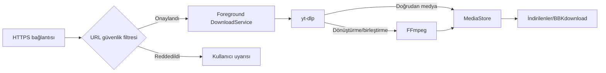

<p align="center">
  
</p>

<p align="center">
  <a href="https://github.com/Batuhanbey-kose/BBKdownload/releases/download/v0.1.4/BBKdownload.apk">
    
  </a>
</p>

<p align="center">
  
  
  
</p>

<p align="center">
  <strong>Reklam yok · Üyelik yok · Takip yok</strong><br />
  Video, MP3 ve kapak dosyalarını doğrudan telefonuna kaydet.
</p>

## Telefona Nasıl Kurulur?

1. Yukarıdaki büyük **TELEFONA İNDİR** butonuna bas.
2. İnen `BBKdownload.apk` dosyasını aç ve **Yükle** seçeneğine bas.
3. Telefon izin isterse tarayıcın için **Bilinmeyen uygulamaları yükle** iznini aç.

Hepsi bu. Uygulamayı aç, bağlantıyı yapıştır ve indirme biçimini seç.

> APK Android 10 ve üzeri ARM64 telefonlar içindir. GitHub indirme sayfası açılırsa **Assets** bölümündeki `BBKdownload.apk` dosyasına dokun.

> [!NOTE]
> **Play Protect indirmeyi veya kurulumu bekletirse:** BBKdownload Google Play'de yayımlanmadığı için bazı cihazlar APK'yı `İndiriliyor...` ekranında tutabilir ya da bilinmeyen uygulama uyarısı gösterebilir. Önce sunulan **Yine de yükle** seçeneğini kullan. Bu seçenek yoksa:
>
> 1. Yalnızca yukarıdaki resmi GitHub bağlantısını kullandığından emin ol.
> 2. Play Store > profil resmi > **Play Protect** > Ayarlar bölümündeki **Uygulamaları Play Protect ile tara** seçeneğini geçici olarak kapat.
> 3. APK'yı indirip kurduktan sonra aynı seçeneği hemen yeniden aç.
> 4. Play Protect ekranındaki **Tara** düğmesiyle kontrol yap; resmi yayın APK'sında sorun bulunmamalıdır.
>
> Play Protect'i kapalı bırakma ve APK'yı başka kaynaklardan indirme.

## Ne İndirir?

| Video | MP3 | Kapak |
|---|---|---|
| Kalite seçerek MP4 kaydet | Sesi 192 kbps MP3'e çevir | Gönderi kapağını JPG kaydet |

Desteklenen bağlantılar: **YouTube, X/Twitter, TikTok, Instagram, Reddit, Facebook** ve deneysel olarak **Threads**.

Dosyalar telefonundaki `İndirilenler/BBKdownload` klasörüne gelir. Bağlantıyı başka bir uygulamadan **Paylaş > BBKdownload** diyerek de gönderebilirsin.

Uygulama içinden seçilebilen 10 tema vardır: **Neon BBK, Zümrüt, Mor Gece, Gün Batımı, Okyanus, Gül, Siyah Beyaz, Matrix, Cyber Sarı ve Buz**. Seçimin telefonda saklanır.

## Güvenli mi?

- Reklam ve kullanıcı takibi yoktur.
- Konum, kamera, mikrofon ve rehber izni istemez.
- İndirme geçmişini bir sunucuya göndermez.
- Yalnızca desteklenen platformların güvenli HTTPS bağlantılarını kabul eder.
- Gerekli platform oturumları yalnızca Android'in uygulamaya özel alanında tutulur.

## Özel Hesaplar

- Herkese açık içerikler oturum açmadan indirilebilir.
- Özel hesaptaki bir içerik yalnızca o hesabı takip eden ve içeriği görme izni bulunan kullanıcı kendi hesabıyla **Gerekirse Aç** bölümünden oturum açarsa işlenebilir.
- İçerik oturum açıldıktan sonra platformda görünmüyorsa BBKdownload da içeriği göremez ve indiremez.
- Uygulama özel hesap, erişim izni, DRM veya ücretli içerik korumasını aşmaz.

## Hata Bildirimi ve Öneriler

Hata raporu veya özellik önerisi için **[GitHub Issues](https://github.com/Batuhanbey-kose/BBKdownload/issues)** bölümünü kullanın. Yeni kayıt açarken uygun şablonu seçin.

> Issue içine oturum çerezi, parola, token, özel hesap bağlantısı veya kişisel bilgi eklemeyin. Güvenlik açıklarını `SECURITY.md` içindeki yöntemle özel olarak bildirin.

Hazır sürüm ve checksum: **[BBKdownload v0.1.4](https://github.com/Batuhanbey-kose/BBKdownload/releases/tag/v0.1.4)**

<details>
<summary><strong>Geliştiriciler için teknik bilgiler</strong></summary>

### Teknoloji

| Katman | Seçim |
|---|---|
| Dil | Kotlin 2.1.20 |
| Android | minSdk 29, targetSdk 35 |
| İndirme motoru | youtubedl-android 0.18.1 |
| Extractor | Sabit yt-dlp 2026.07.04 |
| Medya | Paket içi FFmpeg + QuickJS |
| Depolama | Scoped Storage + MediaStore |
| ABI | arm64-v8a |

Paketlenen `yt-dlp` SHA-256:

```text
495be29ff4d9d4e9be7eabdfef225221e5d5282e77f2f505abc6dca80349f3fd
```

### Akış



### Derleme

```powershell
.\gradlew.bat testDebugUnitTest lintDebug assembleDebug
```

İmzalı release için `keystore.properties.example` dosyasını temel alarak Git tarafından izlenmeyen `keystore.properties` dosyanı oluştur:

```powershell
.\gradlew.bat testDebugUnitTest lintRelease assembleRelease
```

Release çıktısı `dist/BBKdownload.apk` konumuna kopyalanır. Release anahtarı, parola, APK ve derleyici çıktıları Git tarafından yok sayılır.

### Güvenlik ve Katkı

- Güvenlik modeli: [`SECURITY.md`](SECURITY.md)
- Katkı rehberi: [`CONTRIBUTING.md`](CONTRIBUTING.md)
- Üçüncü taraflar: [`THIRD_PARTY_NOTICES.md`](THIRD_PARTY_NOTICES.md)
- Lisans: [`GNU GPL v3.0`](LICENSE.md)
- Hata ve öneriler: [`GitHub Issues`](https://github.com/Batuhanbey-kose/BBKdownload/issues)

</details>

## Kullanım Sınırları

Uygulama filigran, DRM, ücretli içerik veya özel hesap korumasını aşmaz. Yalnızca sana ait ya da indirme iznin bulunan içerikleri kullan.

<p align="center">
  <strong>BBKdownload</strong><br />
  Bağlantıyı bırak, dosyanı al.
</p>
